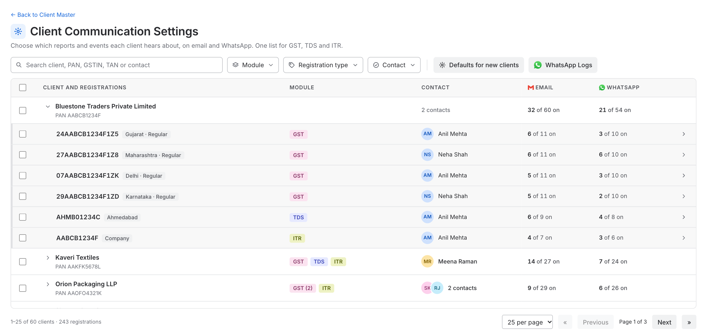
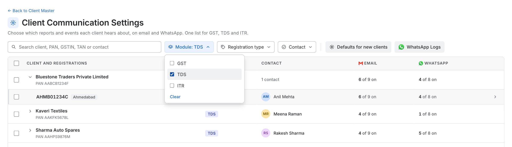
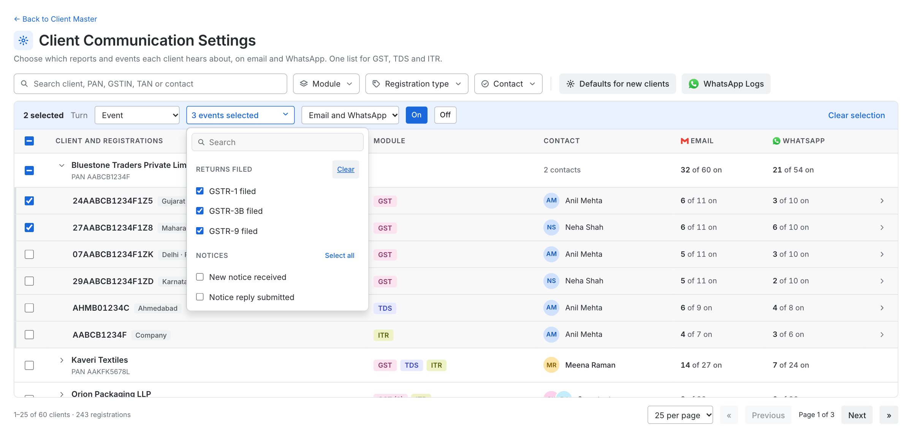
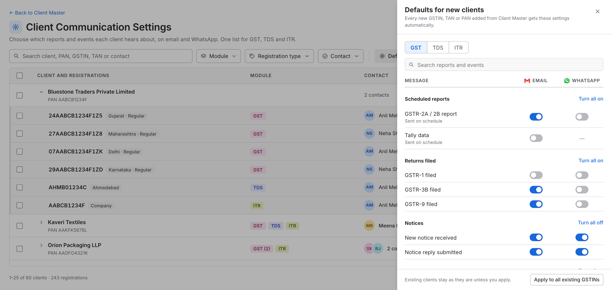
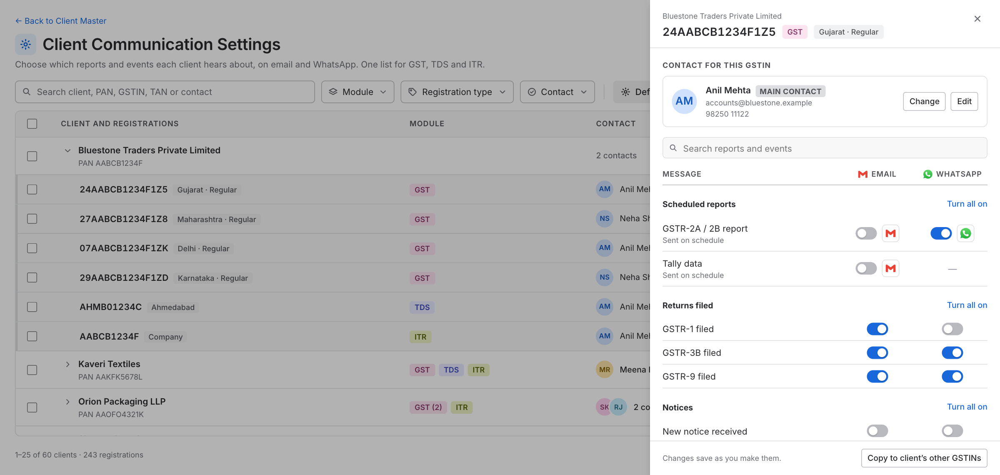
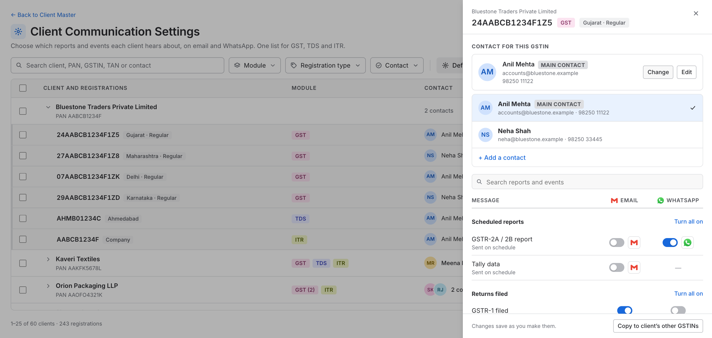
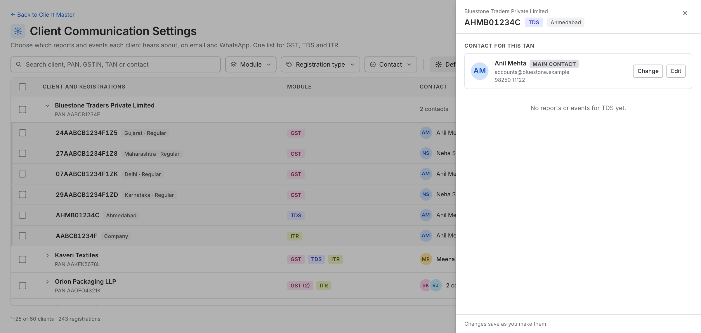
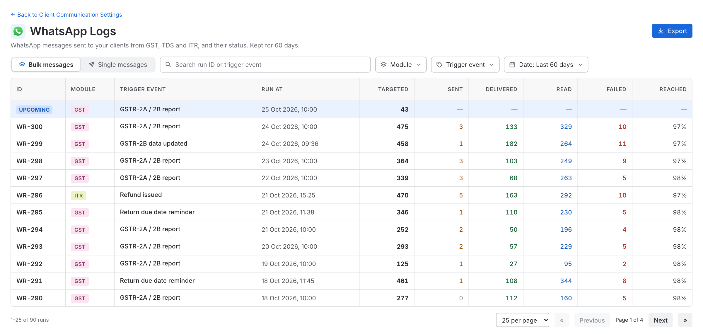
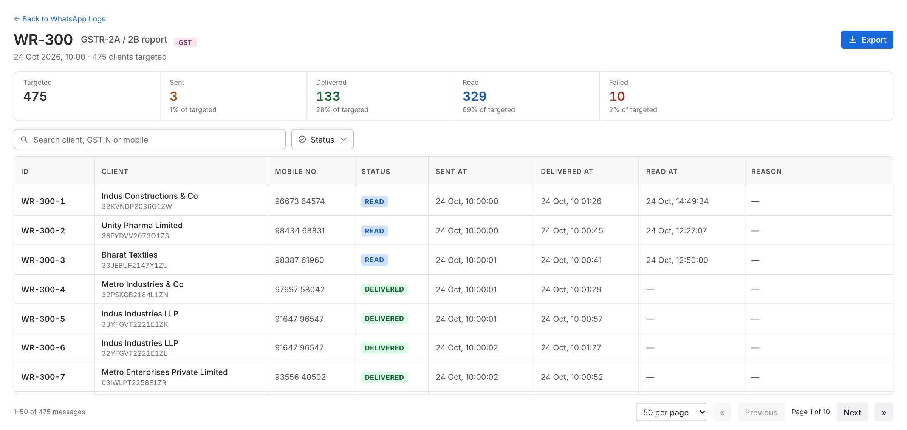
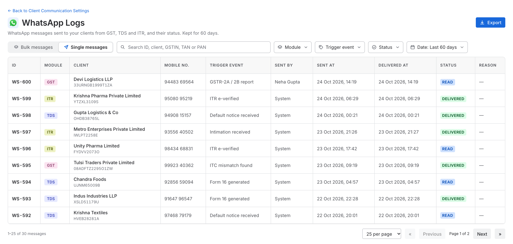

# Client Communication Settings and WhatsApp Logs for GST, TDS and ITR: Business Requirements Document

| | |
|---|---|
| **Product** | Spectrum Cloud |
| **Modules** | GST, TDS and ITR |
| **Feature** | **Client Communication Settings** (one page for all three modules) and **WhatsApp Logs** (all three modules) |
| **Document status** | Draft v1 |
| **Prototype** | https://kartikkhandelwal-pm.github.io/client-communication-settings-all-modules/ (sample data only) |

---

## 1. Overview

### 1.1 Background

A firm can choose which messages each of its clients receives automatically, on **email** or on **WhatsApp**:

- **Scheduled reports**, sent on a schedule. Example: the GSTR-2A / 2B report.
- **Events**, which tell the client when something happens. Example: GSTR-3B filed, Form 16 generated, ITR e-verified.

This is set per client on the **Client Communication Settings** page. Today the page covers the GST module only. TDS and ITR do not have it, and WhatsApp messages have no log: the user cannot see how many clients a scheduled WhatsApp run was meant for, how many messages were sent, or what happened to them.

### 1.2 What we are doing

1. **One Client Communication Settings page for GST, TDS and ITR.** A client can have several **GSTINs** (GST), several **TANs** (TDS) and one **PAN** (ITR). Settings are kept **per GSTIN, TAN or PAN**, because each can have its own contact person and its own switches.
2. **Email and WhatsApp for every report and event.** Each has its own switch per channel, wherever the channel is supported.
3. **WhatsApp Logs for all modules.** The user can see every WhatsApp message sent for the reports and events of this page: for a scheduled run, how many clients were targeted, how many messages were sent, and the status of each.

### 1.3 Goals

The user can:

1. See **all clients in one list**, and open any client to see its GSTINs, TANs and PAN.
2. Choose, for every GSTIN, TAN and PAN, **which reports and events go out on email and on WhatsApp**.
3. Choose **who receives them**: the client's main contact, or another contact of the client.
4. Change many registrations at once (bulk), copy settings to the client's other registrations, and set **defaults for new clients**.
5. Send a scheduled report to one client straight away.
6. See, for every WhatsApp run, **how many clients were targeted** and what happened to the messages, and see in advance how many clients the next scheduled run will target.
7. Find a client, registration, run or message quickly (search, filters, export).

### 1.4 Scope

- One Client Communication Settings page for GST, TDS and ITR.
- Email and WhatsApp switch for every report and event, per GSTIN, TAN and PAN.
- A contact for each registration.
- Bulk change, copy, defaults for new clients, and the Send button.
- WhatsApp Logs for GST, TDS and ITR.

---

## 2. Key concepts

Read this section first. The rest of the document uses these terms.

### 2.1 Client, registration and contact

| Term | What it is |
|---|---|
| **Client** | A business the firm works for. It has one PAN, a list of contacts, and one or more registrations |
| **Registration** | A **GSTIN** (GST module), a **TAN** (TDS module) or a **PAN** (ITR module). Settings are saved for each one |
| **Module** | GST, TDS or ITR. It decides which reports and events a registration has |
| **Contact** | A person at the client: name, email, mobile number. The messages of a registration go to its contact |
| **Main contact** | The client's first contact. A registration uses it unless another contact is picked for that registration |

A client with 4 GSTINs, 1 TAN and 1 PAN has **6 registrations**, each with its own switches.

### 2.2 Reports and events

| Kind | What it is | Where the user sets it |
|---|---|---|
| **Scheduled report** | A report sent on a schedule. Example: GSTR-2A / 2B report, Tally data | Group **Scheduled reports** in a registration. Has a Send button |
| **Event** | A message sent when something happens. Example: GSTR-3B filed, Form 16 generated, ITR e-verified | Groups such as Returns filed, Notices, Payments |

For each report and event there is a switch for **Email** and a switch for **WhatsApp**. A report or event may support only one channel (for example Tally data goes by email only). The other switch then shows a dash.

**Which reports and events exist for GST, TDS and ITR:** `{List to be added by the domain team}`

The domain team gives, for each module: the **name**, its **group**, which **channels** it supports, and whether it is a **scheduled report** or an **event**.

> The names on the prototype screens (for example "Form 24Q filed", "Refund issued", "Monthly TDS summary") are **examples only**. The final lists will be added by the domain team. The page must work with any list: a module with no report or event shows "No reports or events for TDS yet." and its numbers show a dash.

### 2.3 When a switch cannot be turned on

- A contact **without an email** cannot receive email messages. Their Email switches are greyed out and off.
- A contact **without a mobile number** cannot receive WhatsApp messages. Their WhatsApp switches are greyed out and off.
- When a registration is given another contact, or a contact loses their email or mobile number, any switch that is no longer possible is **turned off**.

### 2.4 Two kinds of WhatsApp messages in the logs

| Kind | What it is | Where it shows |
|---|---|---|
| **Bulk message** | One run that goes **to many clients together at a scheduled time**. Example: the GSTR-2A / 2B report that goes to every registration whose WhatsApp switch is on | **Bulk messages** tab. Opening one shows every message inside it |
| **Single message** | One message **to one client**. Example: the Send button, or an event for one client | **Single messages** tab |

**The rule:** sent together to many clients at one time = Bulk. Sent to one client = Single.

A bulk run can have thousands of messages, so each run has **its own page**.

### 2.5 Trigger event

Every message is sent because of something: the report or event that caused it. We call this the **trigger event**. It is shown in the logs and can be used as a filter.

**List of all trigger events, and whether each is a bulk run or a single message:** `{List to be added by the domain team}`

### 2.6 IDs the user sees

Users never see the codes of the WhatsApp provider. They see short IDs made by Spectrum Cloud.

| What | Format | Example |
|---|---|---|
| Bulk run | `WR-` + number | `WR-300` |
| One message inside a bulk run | run ID + position | `WR-300-1`, `WR-300-2` … |
| Single message | `WS-` + number | `WS-601` |

### 2.7 Numbers and statuses

**Numbers for a bulk run**

| Number | Meaning |
|---|---|
| **Targeted** | Messages selected for this run: registrations whose switch was **on** when the run started, and that have a mobile number |
| **One count per status** | How many messages are in each status (below) |
| **Reached** | Delivered + Read, as a percentage of Targeted |

The numbers add up: **Targeted is the total of all the status counts.**

**Statuses.** The status of every message is **taken from the WhatsApp provider** and shown in plain words, as the provider gives it. In the prototype these are:

| Status | Meaning |
|---|---|
| **Sent** | Handed over to WhatsApp. Not yet on the client's phone |
| **Delivered** | Reached the client's phone |
| **Read** | The client opened the message |
| **Failed** | Could not be delivered. The reason is shown |

The final list of statuses follows what the provider gives us.

---

## 3. How the user opens the page

**Client Settings tab.** In the GST, TDS and ITR modules, the client **profile drawer** has a **Client Settings** tab. Clicking it opens the **Client Communication Settings** page. It is the same page from all three modules.

The page has a **Back to Client Master** link.

**WhatsApp Logs.** A **WhatsApp Logs** button on the settings page opens the logs. The logs page has a **Back to Client Communication Settings** link.

---

## 4. The Client Communication Settings page

### 4.1 Toolbar

From left to right:

- **Search:** by client name, PAN, GSTIN, TAN, or the contact's name, email or mobile number.
- **Filters:** Module, Registration type, Contact. Each filter lets the user tick **more than one choice**.
- **Defaults for new clients** and **WhatsApp Logs** buttons, after a thin divider. These are action buttons, not filters.

| Filter | Choices |
|---|---|
| **Module** | GST, TDS, ITR |
| **Registration type** | Every registration type that exists in the system, for example Regular or Composition for GST, Company or Firm for ITR |
| **Contact** | Missing email, Missing mobile |

A filter shows only its name when nothing is picked ("Module"), and the choice when something is ("Module: TDS", or "Module: 2 selected"). A long choice is cut with "…" and shown in full when the pointer is on it. When a filter has 8 or more choices it gets a search box. A **Clear** link removes the choices.

### 4.2 Table

The table lists **clients**. A client row opens to show its **registrations** underneath.

| Column | Notes |
|---|---|
| Checkbox | Tick a client to tick all its registrations, or tick single registrations. Used for bulk change |
| **Client and registrations** | A client row shows the name, with the PAN below it. A registration row shows its GSTIN, TAN or PAN, with its type or place (for example "Gujarat · Regular") |
| **Module** | A **closed** client row shows a tag for each module it has, with the number when there are several: `GST (4)  TDS  ITR`. An **open** client row leaves it empty, and each registration row shows its own tag |
| **Contact** | A client row shows the contact's picture (initials), with the name. With more than one contact it shows two pictures and "2 contacts", and a "+" count when there are more. A registration row shows its contact, and "no email" or "no mobile" in orange when one is missing |
| **Email** | "**x** of **y** on": how many of the registration's email messages are on. A client row adds up its registrations |
| **WhatsApp** | The same, for WhatsApp |
| Arrow | Opens the registration (section 5) |

- Only messages that support the channel are counted. A module with no reports or events shows a dash.
- A client with more than 5 GSTINs shows the first 5, and a **Show all N GSTINs** link.
- Clicking a client row opens or closes it. Clicking a registration row opens its panel. While a search is typed, matching clients open by themselves.
- Paging: 10, 25 or 50 clients per page, with first, previous, next and last page, and a count of clients and registrations. The page works with thousands of clients: the table scrolls, and its header stays in view.

### 4.3 Bulk change

Tick any registrations (or whole clients). A bar appears above the table:

**Turn** [ Scheduled report / Event ] [ choice ] [ Email and WhatsApp / Email only / WhatsApp only ] **On** **Off**

- **Scheduled report:** pick one report.
- **Event:** pick **one or more** events from a list with a search box. Each group has a **Select all** link. The button shows "3 events selected".
- Only the reports and events of the **modules that were ticked** are offered. When several modules are ticked, the group names carry the module name (for example "GST · Returns filed").
- The change is applied to every ticked registration of the module that owns the report or event. A registration of another module is skipped.
- A registration whose contact has no email (or no mobile number) is skipped for that channel when turning **On**.
- A message confirms the result, for example "3 events turned on for up to 2 registrations. 1 skipped, no contact for that channel."
- **Clear selection** unticks everything.

### 4.4 Defaults for new clients

A panel with a tab for each module (GST, TDS, ITR). The user chooses which reports and events are **on** for every **new registration** of that module. A new registration added from Client Master gets these settings **automatically**.

- **Existing registrations are not changed**, unless the user clicks **Apply to all existing GSTINs** (or TANs, PANs). A confirmation asks first: "This changes all N existing GSTINs. Their current GST settings are replaced by the defaults above."
- Changes to the defaults are saved on their own.

### 4.5 Saving

Every change on the page is saved on its own, a moment after it is made, with a short "Saved" message. There is no Save button.

---

## 5. A registration (side panel)

Clicking a registration opens a panel on the right. It closes with the ✕, the Esc key, or a click outside the panel. Nothing needs to be saved when closing, because every change is already saved.

The header shows the client name, the GSTIN, TAN or PAN, its module tag and its type.

### 5.1 Contact

A card shows the contact that receives this registration's messages: name, email and mobile number. A contact who is the client's main contact carries a **Main contact** label. If something is missing, it shows in orange ("No email").

| Button | What it does |
|---|---|
| **Change** | Shows all the contacts of the client. The user picks one for this registration. Picking the main contact again makes the registration follow the main contact |
| **Edit** | Opens a form with the contact's name, email and mobile number, already filled in |
| **+ Add a contact** | In the Change list. Opens the same form, empty, and the new contact is picked for this registration |

- **Name** is required. Add **at least one of email or mobile number**; both can be given. **Email** must look like an email. **Mobile number** must be a 10-digit Indian number. A message goes out only on a channel whose detail is filled in.
- Editing a contact **changes it everywhere it is used on this page** (for example all 4 GSTINs that use the same contact). The form says how many registrations are affected.
- The contacts are **taken from the client's contacts in the application**. A contact edited or added on this page is **saved for this page only**. It does not change the contact in Client Master.
- When the contact of a registration changes, switches that the new contact cannot receive are turned off (section 2.3).

### 5.2 Reports and events

Under the contact, a search box and one list of every report and event of the module, in groups (for example Scheduled reports, Returns filed, Notices).

- One header at the top of the list names the columns: **Message**, **Email**, **WhatsApp**.
- Each row has a switch for each channel. A channel the message does not support shows a dash.
- Each group has one link on the right: **Turn all on**, or **Turn all off** when everything in the group is already on.
- Switches for a channel the contact cannot receive are greyed out.
- Search finds a report, event or group by name.

### 5.3 Send button

Next to the switch of a **scheduled report** there is a small email or WhatsApp icon. Clicking it **sends that report to this registration's contact straight away**, even when the switch is off. It is greyed out when the contact has no email or mobile number. A message says what was sent and to whom.

A **WhatsApp** message sent this way is written to WhatsApp Logs as a **Single message** (section 6.5).

### 5.4 Copy to the client's other registrations

The footer has **Copy to client's other GSTINs** (or TANs, PANs). It copies the switches on this page to the **other registrations of the same module of this client only**. No other client changes, and the contacts stay as they are.

A confirmation asks first: "This changes the other 3 GSTINs of {client}. Their GST switches are replaced by the ones on this page. Contacts stay as they are." The button is not shown when the client has no other registration of that module.

---

## 6. WhatsApp Logs

### 6.1 What it shows

Every WhatsApp message sent for the **reports and events set up on this page** (scheduled reports, events and the Send button), for GST, TDS and ITR, in two tabs: **Bulk messages** and **Single messages**. Logs are kept for **60 days** (a setting that can be changed later). The page lists only the modules that have reports or events. A message is logged once, and its status is updated as the provider reports it.

### 6.2 Toolbar

- **Search:** Bulk tab by run ID or trigger event. Single tab by ID, client, GSTIN, TAN, PAN or trigger event.
- **Filters:** Module, Trigger event, Status (Single tab only), Date. **Module, Trigger event and Status accept more than one choice.** Date accepts one.
- Choosing a Module narrows the Trigger event choices to that module's events.
- **Date:** Last 60 days, Last 30 days, Last 7 days, Today (since midnight). Cannot go beyond the retention limit.
- **Export:** downloads what is on screen as a CSV file, with the module and the GSTIN, TAN or PAN as their own columns.

### 6.3 Bulk messages tab

One row per **run** (for example, the GSTR-2A / 2B report of one day). A run answers: **how many clients were targeted that day, and what happened.**

| Column | Notes |
|---|---|
| ID | `WR-…`, or an **Upcoming** tag on the first row (see below) |
| Module | GST, TDS or ITR |
| Trigger event | From the domain list |
| Run at | When the run started |
| **Targeted** | Messages selected for this run |
| One column per status | Sent, Delivered, Read, Failed. Follows the statuses the provider gives |
| Reached | Delivered + Read, out of Targeted |

**Upcoming row.** The first row of the list (first page only) is the **next scheduled report**. Today this is the **GSTR-2A / 2B report**. Any other scheduled WhatsApp report that the domain team adds gets its own Upcoming row in the same way. The row has an **Upcoming** tag, shows **when it will run**, and shows **how many registrations it will target right now**: those whose WhatsApp switch for this report is on and whose contact has a mobile number. The other columns show a dash, because nothing has been sent yet.

- The number **follows the switches**. If the user turns a switch on or off, or changes a contact, the number changes.
- When the run starts, the number is **fixed**, and the row becomes a normal run with its results.
- The row is hidden when the user searches or filters for something else.

### 6.4 When the user clicks a run: the run page

A separate page. It shows:

- The run ID, the trigger event, the module tag, when it ran, and how many were targeted.
- **Summary cards:** Targeted, and one card per status, each with its share of targeted.
- A table with **one row per message**, with search and a multi-choice Status filter.

| Column | Notes |
|---|---|
| ID | `WR-300-1` (run ID + position) |
| Client | Name, with the **GSTIN, TAN or PAN** below it |
| Mobile no. | |
| Status | |
| Sent at | |
| Delivered at | |
| Read at | |
| Reason | The failure reason |

### 6.5 Single messages tab

One row per message sent to one client.

| Column | Notes |
|---|---|
| ID | `WS-…` |
| Module | GST, TDS or ITR |
| Client | Name, with the **GSTIN, TAN or PAN** below it |
| Mobile no. | |
| Trigger event | From the domain list. The report's name when sent with the Send button |
| Sent by | A person (Send button), or **System** |
| Sent at | |
| Delivered at | |
| Status | |
| Reason | The failure reason |

---

## 7. Where the data comes from

**From the application:** clients, their PAN and contacts, and the registrations of each client (GSTIN, TAN, PAN, with type or place). A newly added registration gets the defaults of its module.

**Saved by Spectrum Cloud:** the Email and WhatsApp switch of every report and event for each registration, the contact picked for each registration, the contacts edited or added on this page, and the defaults of each module.

**WhatsApp.** We send WhatsApp through **Rampwin**. The status of every message and its delivery details (delivered time, read time, failure reason) are taken from Rampwin. The user must never see the name Rampwin or its codes.

- Rampwin API reference: https://rampwin-api.readme.io
- Rampwin help docs: https://docs.rampwin.com
