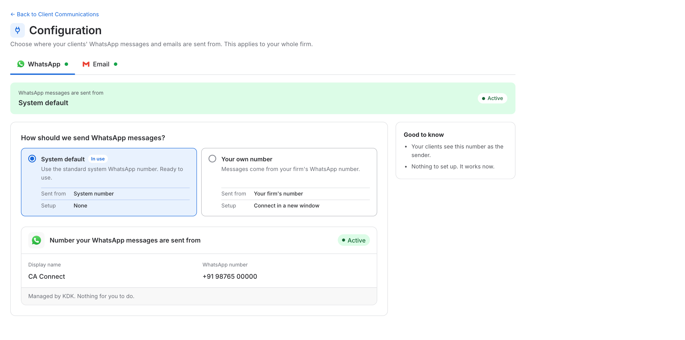
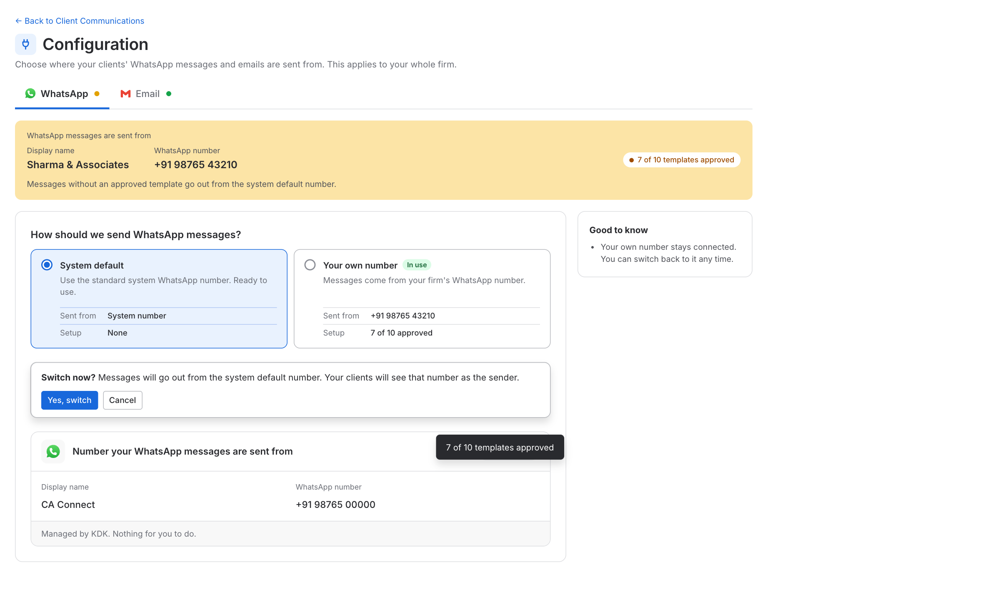
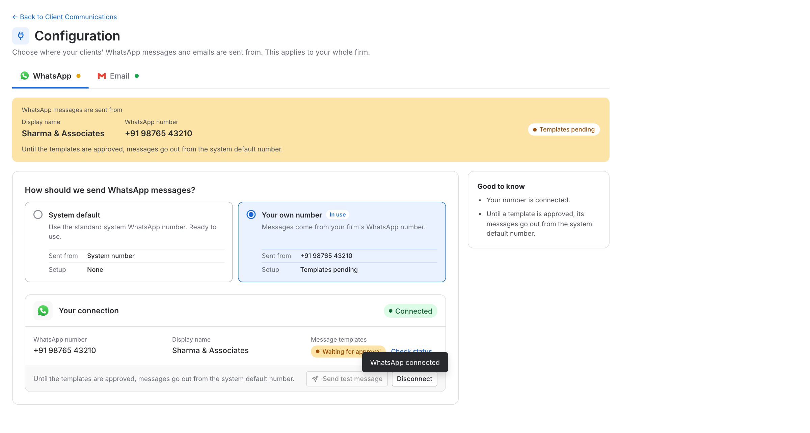
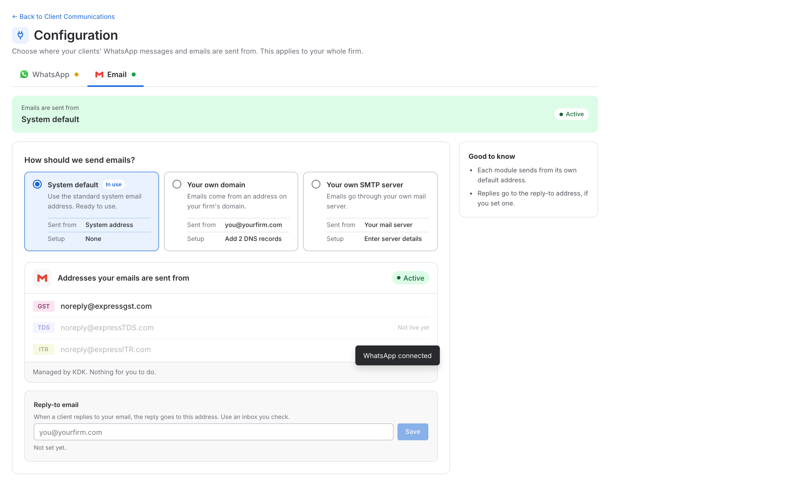
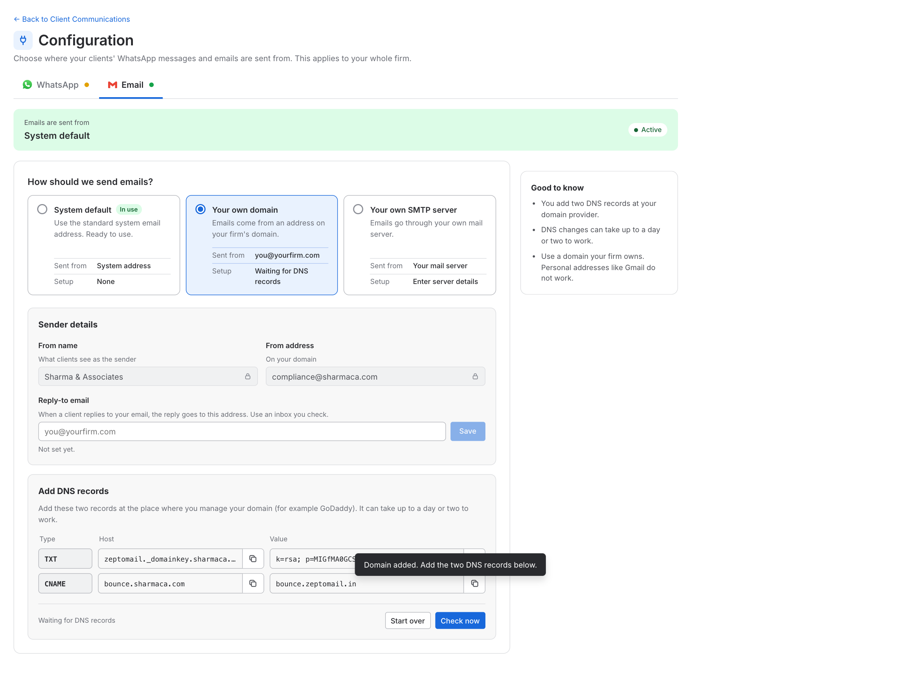
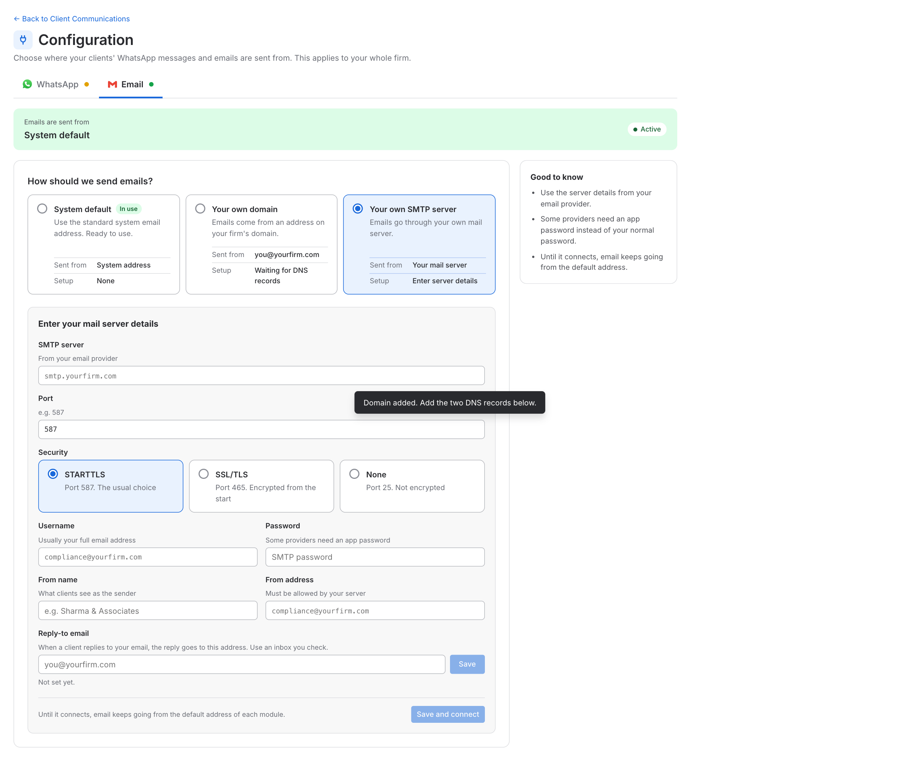

# Client Communications for GST, TDS and ITR: Business Requirements Document

| | |
|---|---|
| **Feature** | Client Communications, Configuration and WhatsApp Logs |
| **Document status** | Draft v1 |
| **Prototype** | https://kartikkhandelwal-pm.github.io/client-communication-settings-all-modules/ (sample data only) |

---

## 1. Overview

### 1.1 Background

A firm can choose which messages each of its clients receives automatically, on **email** or on **WhatsApp**:

- **Scheduled reports**, sent on a schedule. Example: the GSTR-2A / 2B report.
- **Events**, which tell the client when something happens. Example: GSTR-3B filed, Form 16 generated, ITR e-verified.

This is set per client on the **Client Communications** page. Today the page covers the GST module only. TDS and ITR do not have it. WhatsApp messages have no log: the user cannot see how many clients a scheduled WhatsApp run was meant for, how many messages were sent, or what happened to them. And the firm cannot choose the WhatsApp number or the email address its messages come from: they always go from the system's own number and address.

### 1.2 What we are doing

1. **One Client Communications page for GST, TDS and ITR.** A client can have several **GSTINs** (GST), several **TANs** (TDS) and one **PAN** (ITR). Settings are kept **per GSTIN, TAN or PAN**, because each can have its own contact person and its own switches.
2. **Email and WhatsApp for every report and event.** Each has its own switch per channel, wherever the channel is supported.
3. **WhatsApp Logs for all modules.** The user can see every WhatsApp message sent for the reports and events of this page: for a scheduled run, how many clients were targeted, how many messages were sent, and the status of each. Every message also shows **which WhatsApp number it was sent from**.
4. **A Configuration page for the whole firm.** The firm chooses where its WhatsApp messages and emails are sent from: the **system default**, or its **own** WhatsApp number, email domain or mail server.

### 1.3 Goals

The user can:

1. See **all clients in one list**, and open any client to see its GSTINs, TANs and PAN.
2. Choose, for every GSTIN, TAN and PAN, **which reports and events go out on email and on WhatsApp**.
3. Choose **who receives them**: the client's main contact, or another contact of the client.
4. Change many registrations at once (bulk), copy settings to the client's other registrations, and set **defaults for new clients**.
5. Send a scheduled report to one client straight away.
6. See, for every WhatsApp run, **how many clients were targeted** and what happened to the messages, and see in advance how many clients the next scheduled run will target.
7. Find a client, registration, run or message quickly (search, filters, export).
8. Choose **where WhatsApp messages and emails are sent from**, and always see which choice is in use.

### 1.4 Scope

- One Client Communications page for GST, TDS and ITR.
- Email and WhatsApp switch for every report and event, per GSTIN, TAN and PAN.
- A contact for each registration.
- Bulk change, copy, defaults for new clients, and the Send now buttons.
- Configuration: where WhatsApp messages and emails are sent from, for the whole firm.
- WhatsApp Logs for GST, TDS and ITR, with the sending number on every message.

---

## 2. Key concepts

Read this section first. The rest of the document uses these terms.

### 2.1 Client, registration and contact

| Term | What it is |
|---|---|
| **Client** | A business the firm works for. It has one PAN, a list of contacts, and one or more registrations |
| **Registration** | A **GSTIN** (GST module), a **TAN** (TDS module) or a **PAN** (ITR module). Settings are saved for each one |
| **Module** | GST, TDS or ITR. It decides which reports and events a registration has |
| **Contact** | A person at the client: name, email, mobile number. The messages of a registration go to its contact |
| **Main contact** | The client's first contact. A registration uses it unless another contact is picked for that registration |

A client with 4 GSTINs, 1 TAN and 1 PAN has **6 registrations**, each with its own switches.

### 2.2 Reports and events

| Kind | What it is | Where the user sets it |
|---|---|---|
| **Scheduled report** | A report sent on a schedule. Example: GSTR-2A / 2B report, Tally data | Group **Scheduled reports** in a registration. Has a Send button |
| **Event** | A message sent when something happens. Example: GSTR-3B filed, Form 16 generated, ITR e-verified | Groups such as Returns filed, Notices, Payments |

For each report and event there is a switch for **Email** and a switch for **WhatsApp**. A report or event may support only one channel (for example Tally data goes by email only). The other switch then shows a dash.

**Which reports and events exist for GST, TDS and ITR:** `{List to be added by the domain team}`

The domain team gives, for each module: the **name**, its **group**, which **channels** it supports, and whether it is a **scheduled report** or an **event**.

> The names on the prototype screens (for example "Form 24Q filed", "Refund issued", "Monthly TDS summary") are **examples only**. The final lists will be added by the domain team. The page must work with any list: a module with no report or event shows "No reports or events for TDS yet." and its numbers show a dash.

### 2.3 When a switch cannot be turned on

- A contact **without an email** cannot receive email messages. Their Email switches are greyed out and off.
- A contact **without a mobile number** cannot receive WhatsApp messages. Their WhatsApp switches are greyed out and off.
- When a registration is given another contact, or a contact loses their email or mobile number, any switch that is no longer possible is **turned off**.

### 2.4 Two kinds of WhatsApp messages in the logs

| Kind | What it is | Where it shows |
|---|---|---|
| **Bulk message** | One run that goes **to many clients together at a scheduled time**. Example: the GSTR-2A / 2B report that goes to every registration whose WhatsApp switch is on | **Bulk messages** tab. Opening one shows every message inside it |
| **Single message** | One message **to one client**. Example: the Send button, or an event for one client | **Single messages** tab |

**The rule:** sent together to many clients at one time = Bulk. Sent to one client = Single.

A bulk run can have thousands of messages, so each run has **its own page**.

### 2.5 Trigger event

Every message is sent because of something: the report or event that caused it. We call this the **trigger event**. It is shown in the logs and can be used as a filter.

**List of all trigger events, and whether each is a bulk run or a single message:** `{List to be added by the domain team}`

### 2.6 IDs the user sees

Users never see the codes of the WhatsApp provider. They see short IDs made by Spectrum Cloud.

| What | Format | Example |
|---|---|---|
| Bulk run | `WR-` + number | `WR-300` |
| One message inside a bulk run | run ID + position | `WR-300-1`, `WR-300-2` … |
| Single message | `WS-` + number | `WS-601` |

### 2.7 Numbers and statuses

**Numbers for a bulk run**

| Number | Meaning |
|---|---|
| **Targeted** | Messages selected for this run: registrations whose switch was **on** when the run started, and that have a mobile number |
| **One count per status** | How many messages are in each status (below) |
| **Reached** | Delivered + Read, as a percentage of Targeted |

The numbers add up: **Targeted is the total of all the status counts.**

**Statuses.** The status of every message is **taken from the WhatsApp provider** and shown in plain words, as the provider gives it. In the prototype these are:

| Status | Meaning |
|---|---|
| **Sent** | Handed over to WhatsApp. Not yet on the client's phone |
| **Delivered** | Reached the client's phone |
| **Read** | The client opened the message |
| **Failed** | Could not be delivered. The reason is shown |

The final list of statuses follows what the provider gives us.

### 2.8 Where messages are sent from

| Term | What it is |
|---|---|
| **System default** | The WhatsApp number and the email addresses that Spectrum Cloud provides. Ready to use, nothing to set up. Every firm starts here |
| **Your own** | The firm's own WhatsApp number, its own email domain, or its own mail server (SMTP). The firm sets it up once on the Configuration page |
| **In use** | The one choice that WhatsApp (or email) is **actually sent from right now**. There is exactly one for WhatsApp and one for email |
| **Sender** | The WhatsApp number (with its display name) or the email address that the client sees |

WhatsApp and email are chosen **separately**. The choice is for the **whole firm**, not per client. Details are in section 7.

---

## 3. How the user opens the page

**Client Settings tab.** In the GST, TDS and ITR modules, the client **profile drawer** has a **Client Settings** tab. Clicking it opens the **Client Communications** page. It is the same page from all three modules.

The page has a **Back to Client Master** link.

From the Client Communications page the user goes on to three other places:

| Button | Where it is | What it opens |
|---|---|---|
| **Configuration** | Top right, in blue | The Configuration page: where WhatsApp and email are sent from (section 7). Setting it up is **optional**, because the system default already works |
| **WhatsApp Logs** | Toolbar | WhatsApp Logs (section 6) |
| **Email Logs** | Toolbar | Email Logs. It is a separate page with its own BRD, and opens inside the same app. Emails sent through the firm's own SMTP server show the status **SMTP** there (section 7.4) |

Each of these pages has a **Back to Client Communications** link.

**The usual order for a user:** open Client Communications and set what each client receives, then, only if the firm wants its own number or address, go to Configuration, and later use the logs to check what was sent.

---

## 4. The Client Communications page

### 4.1 Toolbar

From left to right:

- **Search:** by client name, PAN, GSTIN, TAN, or the contact's name, email or mobile number.
- **Filters:** Module, Registration type, Contact. Each filter lets the user tick **more than one choice**.
- **Defaults for new clients**, **WhatsApp Logs** and **Email Logs** buttons, after a thin divider. These are action buttons, not filters.
- **Configuration** button, top right of the page, in blue (section 7).

| Filter | Choices |
|---|---|
| **Module** | GST, TDS, ITR |
| **Registration type** | Every registration type that exists in the system, for example Regular or Composition for GST, Company or Firm for ITR |
| **Contact** | Missing email, Missing mobile |

A filter shows only its name when nothing is picked ("Module"), and the choice when something is ("Module: TDS", or "Module: 2 selected"). A long choice is cut with "…" and shown in full when the pointer is on it. When a filter has 8 or more choices it gets a search box. A **Clear** link removes the choices.

### 4.2 Table

The table lists **clients**. A client row opens to show its **registrations** underneath. **All clients are closed when the page opens.**

| Column | Notes |
|---|---|
| Checkbox | Tick a client to tick all its registrations, or tick single registrations. Used for bulk change |
| **Client and registrations** | A client row shows the name, with the PAN below it. A registration row shows its GSTIN, TAN or PAN, with its type or place (for example "Gujarat · Regular") |
| **Module** | A **closed** client row shows a tag for each module it has, with the number when there are several: `GST (4)  TDS  ITR`. An **open** client row leaves it empty, and each registration row shows its own tag |
| **Contact** | A client row shows the contact's picture (initials), with the name. With more than one contact it shows two pictures and "2 contacts", and a "+" count when there are more. A registration row shows its contact, and "no email" or "no mobile" in orange when one is missing |
| **Email** | "**x** of **y** on": how many of the registration's email messages are on. A client row adds up its registrations |
| **WhatsApp** | The same, for WhatsApp |
| Arrow | Opens the registration (section 5) |

- Only messages that support the channel are counted. A module with no reports or events shows a dash.
- A client with more than 5 GSTINs shows the first 5, and a **Show all N GSTINs** link.
- Clicking a client row opens or closes it. Clicking a registration row opens its panel. While a search is typed, matching clients open by themselves.
- Paging: 10, 25 or 50 clients per page, with first, previous, next and last page, and a count of clients and registrations. The page works with thousands of clients: the table scrolls, and its header stays in view.

### 4.3 Bulk change

Tick any registrations (or whole clients). A bar appears above the table:

**Turn** [ Scheduled report / Event ] [ choice ] [ Email and WhatsApp / Email only / WhatsApp only ] **On** **Off**

- **Scheduled report:** pick one report.
- **Event:** pick **one or more** events from a list with a search box. Each group has a **Select all** link. The button shows "3 events selected".
- Only the reports and events of the **modules that were ticked** are offered. When several modules are ticked, the group names carry the module name (for example "GST · Returns filed").
- The change is applied to every ticked registration of the module that owns the report or event. A registration of another module is skipped.
- A registration whose contact has no email (or no mobile number) is skipped for that channel when turning **On**.
- A message confirms the result, for example "3 events turned on for up to 2 registrations. 1 skipped, no contact for that channel."
- **Clear selection** unticks everything.

### 4.4 Defaults for new clients

A panel with a tab for each module (GST, TDS, ITR). The user chooses which reports and events are **on** for every **new registration** of that module. A new registration added from Client Master gets these settings **automatically**.

- **Existing registrations are not changed**, unless the user clicks **Apply to all existing GSTINs** (or TANs, PANs). A confirmation asks first: "This changes all N existing GSTINs. Their current GST settings are replaced by the defaults above."
- Changes to the defaults are saved on their own.

### 4.5 Saving

Every change on the page is saved on its own, a moment after it is made, with a short "Saved" message. There is no Save button.

---

## 5. A registration (side panel)

Clicking a registration opens a panel on the right. It closes with the ✕, the Esc key, or a click outside the panel. Nothing needs to be saved when closing, because every change is already saved.

The header shows the client name, the GSTIN, TAN or PAN, its module tag and its type.

### 5.1 Contact

A card shows the contact that receives this registration's messages: name, email and mobile number. A contact who is the client's main contact carries a **Main contact** label. If something is missing, it shows in orange ("No email").

| Button | What it does |
|---|---|
| **Change** | Shows all the contacts of the client. The user picks one for this registration. Picking the main contact again makes the registration follow the main contact |
| **Edit** | Opens a form with the contact's name, email and mobile number, already filled in |
| **+ Add a contact** | In the Change list. Opens the same form, empty, and the new contact is picked for this registration |

- **Name** is required. Add **at least one of email or mobile number**; both can be given. **Email** must look like an email. **Mobile number** must be a 10-digit Indian number. A message goes out only on a channel whose detail is filled in.
- Editing a contact **changes it everywhere it is used on this page** (for example all 4 GSTINs that use the same contact). The form says how many registrations are affected.
- The contacts are **taken from the client's contacts in the application**. A contact edited or added on this page is **saved for this page only**. It does not change the contact in Client Master.
- When the contact of a registration changes, switches that the new contact cannot receive are turned off (section 2.3).

### 5.2 Reports and events

Under the contact, a search box and one list of every report and event of the module, in groups (for example Scheduled reports, Returns filed, Notices).

- One header at the top of the list names the columns: **Message**, **Email**, **WhatsApp**.
- Each row has a switch for each channel. A channel the message does not support shows a dash.
- Each group has one link on the right: **Turn all on**, or **Turn all off** when everything in the group is already on.
- Switches for a channel the contact cannot receive are greyed out.
- Search finds a report, event or group by name.

### 5.3 Send button

Under the name of a **scheduled report** it says **Send now**, followed by an email icon and a WhatsApp icon. Clicking an icon **sends that report to this registration's contact by that channel straight away**, even when the switch is off. A channel the report does not support has no icon. An icon is greyed out when the contact has no email or mobile number. A message says what was sent and to whom.

A **WhatsApp** message sent this way is written to WhatsApp Logs as a **Single message** (section 6.5).

### 5.4 Copy to the client's other registrations

The footer has **Copy to client's other GSTINs** (or TANs, PANs). It copies the switches on this page to the **other registrations of the same module of this client only**. No other client changes, and the contacts stay as they are.

A confirmation asks first: "This changes the other 3 GSTINs of {client}. Their GST switches are replaced by the ones on this page. Contacts stay as they are." The button is not shown when the client has no other registration of that module.

---

## 6. WhatsApp Logs

### 6.1 What it shows

Every WhatsApp message sent for the **reports and events set up on this page** (scheduled reports, events and the Send button), for GST, TDS and ITR, in two tabs: **Bulk messages** and **Single messages**. Logs are kept for **60 days** (a setting that can be changed later). The page lists only the modules that have reports or events. A message is logged once, and its status is updated as the provider reports it.

Every message shows the **WhatsApp number it was sent from** (the display name, with the number). The number is **saved when the message is sent**, so an old message keeps its number even if the firm later switches to another number or disconnects.

### 6.2 Toolbar

- **Search:** Bulk tab by run ID or trigger event. Single tab by ID, client, GSTIN, TAN, PAN or trigger event.
- **Filters:** Module, Trigger event, **Sent from**, Status (Single tab only) and Date. **Module, Trigger event, Sent from and Status accept more than one choice.** Date accepts one.
- Choosing a Module narrows the Trigger event choices to that module's events.
- **Sent from:** lists every number that messages have gone out from, each with its display name and, in small light text below it, the number. For example "CA Connect" with "+91 98765 00000" below, or the firm's own name and number. Choosing one or more shows only the messages (or runs) sent from them.
- **Date:** Last 60 days, Last 30 days, Last 7 days, Today (since midnight). Cannot go beyond the retention limit. It sits **top right, next to Export**.
- **Export:** downloads what is on screen as a CSV file, with the module and the GSTIN, TAN or PAN as their own columns, and the sending number and name.

### 6.3 Bulk messages tab

One row per **run** (for example, the GSTR-2A / 2B report of one day). A run answers: **how many clients were targeted that day, and what happened.**

| Column | Notes |
|---|---|
| ID | `WR-…`, or an **Upcoming** tag on the first row (see below) |
| Module | GST, TDS or ITR |
| Trigger event | From the domain list |
| **Sent from** | The display name, with the WhatsApp number below it |
| Run at | When the run started |
| **Targeted** | Messages selected for this run |
| One column per status | Sent, Delivered, Read, Failed. Follows the statuses the provider gives |
| Reached | Delivered + Read, out of Targeted |

**Upcoming row.** The first row of the list (first page only) is the **next scheduled report**. Today this is the **GSTR-2A / 2B report**. Any other scheduled WhatsApp report that the domain team adds gets its own Upcoming row in the same way. The row has an **Upcoming** tag, shows **when it will run**, and shows **how many registrations it will target right now**: those whose WhatsApp switch for this report is on and whose contact has a mobile number. The other columns show a dash, because nothing has been sent yet.

- The number **follows the switches**. If the user turns a switch on or off, or changes a contact, the number changes.
- When the run starts, the number is **fixed**, and the row becomes a normal run with its results.
- On the Upcoming row, **Sent from** shows the number that is in use now. The number in use when the run actually starts is the one saved.
- The row is hidden when the user searches or filters for something else, including a Sent from filter that does not include the number in use.

### 6.4 When the user clicks a run: the run page

A separate page. It shows:

- The run ID, the trigger event, the module tag, when it ran, how many were targeted, and **which number it was sent from**.
- **Summary cards:** Targeted, and one card per status, each with its share of targeted.
- A table with **one row per message**, with search and a multi-choice Status filter.

| Column | Notes |
|---|---|
| ID | `WR-300-1` (run ID + position) |
| Client | Name, with the **GSTIN, TAN or PAN** below it |
| Mobile no. | |
| Status | |
| Sent at | |
| Delivered at | |
| Read at | |
| Reason | The failure reason |

### 6.5 Single messages tab

One row per message sent to one client.

| Column | Notes |
|---|---|
| ID | `WS-…` |
| Module | GST, TDS or ITR |
| Client | Name, with the **GSTIN, TAN or PAN** below it |
| Mobile no. | |
| Trigger event | From the domain list. The report's name when sent with the Send button |
| **Sent from** | The display name, with the WhatsApp number below it |
| Sent by | A person (Send button), or **System** |
| Sent at | |
| Delivered at | |
| Status | |
| Reason | The failure reason |

---

## 7. Configuration: where messages are sent from

The Configuration page is where a firm decides which **WhatsApp number** and which **email address** its clients see. It is **for the whole firm**, not for one client. Using it is **optional**: the system default works from the first day.

### 7.1 Layout

- **Tabs: WhatsApp and Email.** Each tab has a small dot: green when all is well, amber when a setup is not finished, red when something needs attention.
- **A strip under the tabs** says where messages are sent from **right now**, with a status. With the system default it says **System default** and *Active*. With the firm's own setup it shows that number or address.
- **How should we send ...?** A question with option cards in one row. Every card has the same parts: a name, one sentence, and a small table (**Sent from** and **Setup**) that shows the real number or address once it is set up.
- **Details** of the chosen card, below the cards.
- **Good to know** on the right: two or three short facts about the chosen card.

A value the user cannot change (for example the From address of a verified domain) is shown as a **grey box with a small lock**. A value the user can change is a normal white box.

### 7.2 Looking at a card and using it are different

This is the most important rule of the page.

- **Clicking a card only shows its details.** It does **not** change where messages go.
- Messages go from the card that has the green **In use** tag. There is one for WhatsApp and one for email.
- To switch, the user clicks a card and then the button in the blue bar above its details, for example **Use my number** or **Use system default instead**.
- **Switching asks first**, for WhatsApp and for email, because it changes what the clients see. The bar turns into a question, for example "Switch now? Messages will go out from the system default number. Your clients will see that number as the sender.", with **Yes, switch** and **Cancel**. Cancel changes nothing. After Yes, a short message confirms the change.
- The automatic switch when a setup finishes (below) does not ask, because the user has just done the setup on purpose.

- A card that is not finished (not connected, not verified) cannot be switched to. Until it is finished, messages keep going from the system default.
- **When the setup finishes, the card is switched to automatically**, because that is why the user did it: when WhatsApp is connected, when the domain is verified, and when the mail server connects.
- **Disconnect** (WhatsApp) and **Start over** (domain) put messages back on the system default.
- Switching back to the system default **does not delete** the firm's own setup. It stays saved, and the user can switch to it again at any time. The card then shows **Not in use**.

### 7.3 WhatsApp

| Card | What it is |
|---|---|
| **System default** | The numbers Spectrum Cloud provides. The details show a **Display name** and **WhatsApp number** for each number. There can be more than one number in future, and each gets its own row. Nothing for the user to do |
| **Your own number** | The firm's own WhatsApp Business number |

**Connecting your own number**

1. The user clicks **Connect your number**. A new window opens, where the user links their WhatsApp Business number.
2. When it is done, Spectrum Cloud **receives the connection details by itself**. The user does not copy or paste anything.
3. The page shows **Your connection**: the **WhatsApp number**, the **Display name** and the status of the message templates. It has **Send test message** and **Disconnect**.
4. The firm's number is then **in use**.

Spectrum Cloud sends the firm's message templates for approval once the number is connected.

**Templates that are not approved yet**

A WhatsApp message can only go out when its template is approved. The page shows this on the connection card as a count: **Waiting for approval**, then for example **7 of 10 approved**, and finally **All approved**, with a **Check status** link. The same count appears on the option card (Setup) and in the strip at the top.

- A message whose template is **approved** goes from the **firm's own number**.
- A message whose template is **not approved yet** goes from the **system default number**, until its template is approved.
- **A rejected template is not shown separately.** It is simply not part of the approved count (for example 7 of 10). Its messages go from the system default number, the same as a template that is still waiting. KDK is told about rejections, so the template can be corrected and sent again. This is not shown to the firm. When the template is approved later, its messages start going from the firm's number by themselves.
- The strip at the top, the connection card and *Good to know* all say this in plain words, for example "Until the templates are approved, messages go out from the system default number."
- **Send test message** is off until at least one template is approved.
- Because of this, one firm's WhatsApp Logs can show **two numbers** for a while. The **Sent from** column and filter (section 6) make it clear which message went from which number.

### 7.4 Email

| Card | What it is |
|---|---|
| **System default** | The email addresses Spectrum Cloud provides, **one for each module**: `noreply@expressgst.com` (GST), `noreply@expressTDS.com` (TDS) and `noreply@expressITR.com` (ITR). An address of a module that **sends email today** is shown as normal. An address of a module that **does not send email yet** is shown **greyed out** with "Not live yet", and becomes normal when that module starts sending email |
| **Your own domain** | The firm sends from an address on its own domain, for example `compliance@yourfirm.com` |
| **Your own SMTP server** | The firm sends through its own mail server |

**Reply-to email.** A client's reply goes to this address. It is a box with a **Save** button. Save is on only when the email looks like an email, and a wrong one shows "Enter a valid email, like name@yourfirm.com." After saving it says "Saved. Replies go to ...". It is the same field for all three cards.

**Your own domain**

1. The user enters the **domain** (for example `yourfirm.com`), the **Email ID** (the part before the @), the **From name**, and the Reply-to email, then clicks **Add domain**. A personal domain such as gmail.com is not accepted: "... is a personal email provider, not a domain you control."
2. The page shows two sections. **Sender details** has the From name and From address (grey boxes with a lock) and the Reply-to email.
3. **Add DNS records** has a short line ("Add these two records at the place where you manage your domain (for example GoDaddy). It can take up to a day or two to work.") and the **two records**. Each record is **one row** like a domain provider's form: **Type**, **Host** and **Value**. Host and Value are read-only boxes with a **copy icon** inside. The icon becomes a tick when copied.
4. The user adds them at the domain provider, then clicks **Check now**. The status goes from *Waiting for DNS records* to *Verified*, or to *Not found yet*, with **Check again** and **Start over**.
5. When it is verified, emails go from the firm's address, and a **Send test email** button appears.

**Your own SMTP server**

The form has: **SMTP server** and **Port**, **Security** (STARTTLS, SSL/TLS or None; choosing one sets the usual port 587, 465 or 25 unless the user typed another port), **Username**, **Password**, **From name**, **From address** and the Reply-to email. **Save and connect** tries the server.

- While it connects, the button says *Connecting...* and email keeps going from the system default.
- If it cannot connect, a note says so and the user can correct the details.
- When it connects, the page shows **Your connection**: SMTP server, Security, Username, From name and From address (the password is never shown again), with **Send test email** and **Edit server**. Emails are now sent through the firm's server.

**Status in Email Logs for SMTP emails.** An email sent through the firm's own SMTP server shows the status **SMTP** in Email Logs. Spectrum Cloud only hands the email to the firm's server. It **cannot see what happens after that**, so it cannot tell whether the email was delivered, bounced, failed or opened. Instead of a status it cannot check, the log says **SMTP**, which means "handed to the firm's own mail server". Emails sent from the system default or from the firm's own domain keep their usual statuses (Delivered, Bounced and so on).

### 7.5 Rules

1. The choice is for **the whole firm**. One own number and one own domain (or mail server) cover **all three modules**, GST, TDS and ITR. The firm does not choose them per module. WhatsApp and email are chosen **separately**.
2. Exactly **one** choice is in use for each channel.
3. A setup that is not finished never takes over: messages keep going from the system default.
4. The firm's own setup is kept when the user switches back to the system default.
5. An email sent through the firm's own SMTP server shows the status **SMTP** in Email Logs, because Spectrum Cloud cannot check what happens after it hands the email over.
6. The user must never see the name of the WhatsApp provider. The DNS values for email are shown **as given**, because the user has to copy them exactly.

---

## 8. Where the data comes from

**From the application:** clients, their PAN and contacts, and the registrations of each client (GSTIN, TAN, PAN, with type or place). A newly added registration gets the defaults of its module.

**Saved by Spectrum Cloud:** the Email and WhatsApp switch of every report and event for each registration, the contact picked for each registration, the contacts edited or added on this page, and the defaults of each module. From the Configuration page: for WhatsApp and for email, **which choice is in use**, and the firm's own setup (the WhatsApp number and display name, the email domain and its status, the SMTP details with the password kept safe and never shown again, and the Reply-to email). For every WhatsApp message: the **name and number it was sent from**, saved at the time it is sent.

**WhatsApp.** We send WhatsApp through **Rampwin**. The status of every message and its delivery details (delivered time, read time, failure reason) are taken from Rampwin. The user must never see the name Rampwin or its codes.

- Rampwin API reference: https://rampwin-api.readme.io
- Rampwin help docs: https://docs.rampwin.com

When a firm connects its own number, the connection details and the approval status of its message templates also come from the WhatsApp provider.

**Email.** For the system default and for the firm's own domain, the status of each email comes from the email provider. For an email sent through the firm's own SMTP server there is no provider status, so Email Logs shows **SMTP**.
